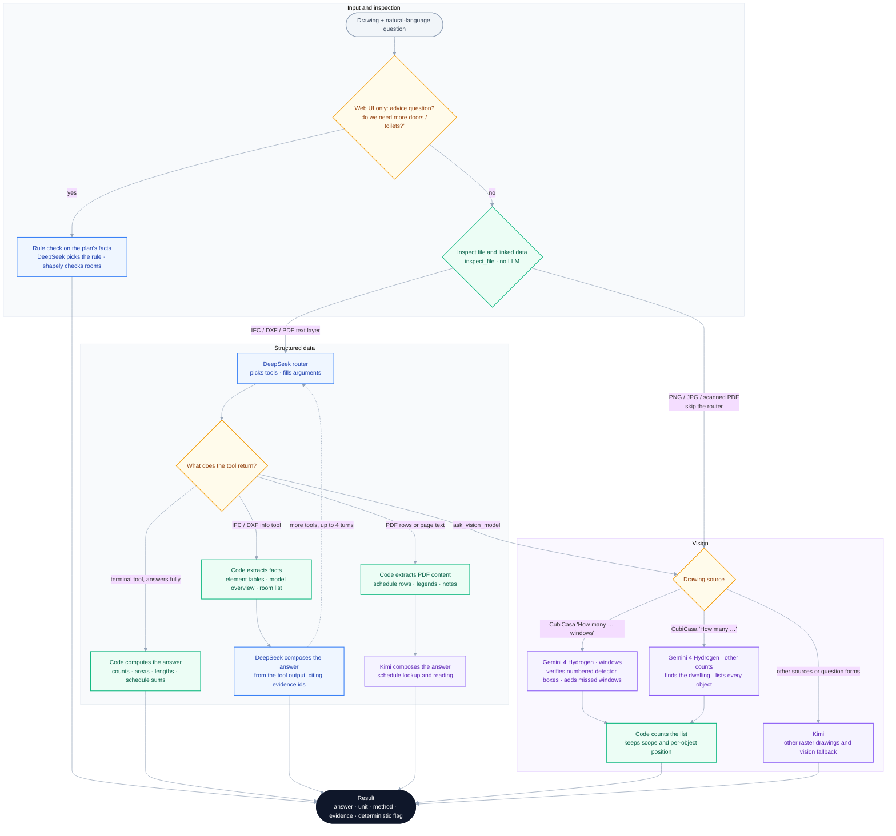

# Answering pipeline

> **Default profile: `hybrid`**
>
> DeepSeek picks the tools; Gemini 4 Hydrogen reads CubiCasa floor plans; Kimi handles PDF schedules and all other vision.
>
> Vision runs at `low` reasoning effort with a 4096-token output cap.

## Overview

**Legend:** green is code (extraction and computation), blue is DeepSeek, purple is Gemini or Kimi, and the dark node is the final result.

## Step by step

### 0. Advice questions (web UI only)

Before the pipeline runs, `/api/ask` passes the question to `stoa/ui/advice.py`. If it is an advice question ("do we need more doors / windows / toilets?", any language), DeepSeek picks one rule from `RULES` (~$0.0001) and labels rooms the multilingual `ROOM_TYPES` patterns don't know. Shapely then checks each room of the rule's types for the component on its boundary or inside it, using the plan's pre-computed facts with the engineer's edits applied. Only exact (CAD/BIM) boundary checks answer "Yes"; detected plans and fixture checks answer "Possibly… check". Any other question goes to `stoa.pipeline.answer`. The CLI and `stoa.eval` call the pipeline directly.

### 1. Inspect the file (`stoa/inspect_file.py`, no LLM)

| Input | Kind | Data used |
| :--- | :--- | :--- |
| `.ifc` | `ifc` | the model |
| `.dxf` | `dxf` | the CAD entities |
| `.pdf` / `.svg` | `vector_pdf` | the IFC it was rendered from (`<model>_<level>.pdf`), a sibling `.dxf` with the same stem, the PDF text layer, and the page itself for vision |
| PDF without text and with fewer than 10 vector drawings | `raster` | scanned sheet: pixels only |
| `.png` / `.jpg` / `.tif` / … | `raster` | pixels only |

A raster file is a **floor plan** (CubiCasa-style) when its path contains a `cubicasa5k` directory. Uploads have no dataset path, so the UI passes `floor_plan=True` for uploaded images and scanned PDFs.

The file kind decides which tools the router is offered. PDF schedule tools are only offered on sheets with no IFC or DXF behind them, because the model answers those exactly.

### 2. Raster shortcut

When the only applicable tool is `ask_vision_model` (a raster drawing), the router call is skipped and the question goes straight to the vision model (section 5).

### 3. Routing (DeepSeek)

The system prompt carries the file line, plus:

- IFC: storey names bottom to top, so "first floor" or "basement" maps to a real storey on the first try, and a piping overview when the model has pipes;
- DXF: the room labels on the plan with their counts;
- PDF: every schedule rebuilt from the ruled grid (table id, columns, sample values) and a reminder to apply every qualifier as a separate filter.

Routing is capped at 800 output tokens, answer composition at 4096 (Kimi always uses its own 4096 default).

### 4. Tool loop

Up to 4 turns. Each terminal tool has an `answer_directly` argument: the router sets it to true only if that one result answers every part of the question.

- **Direct answer (the common case):** on the first turn, a single terminal tool with `answer_directly=true` returns its result as the answer. One LLM call in total.
- **Composed answer:** otherwise the tool outputs go back to the model, which may call more tools or reply with JSON `{answer, unit, explanation, evidence}`. Once `pdf_page_text` or `pdf_table_rows` has run, the remaining turns use the table model (Kimi). On the last turn tools are switched off and the model must answer.
- **Evidence ids:** each tool output ends with a numbered list (`e1`, `e2`, …) of the items it looked at. The model cites the ids it used, and only those are kept, so the UI highlights exactly what the answer counts or sums.
- **Count check:** for a count answer, if the number disagrees with the number of distinct items cited (it said 9 and cited 8 rooms), the cited count wins and the note says "Corrected from 9". This is skipped after schedule rows or page text, where one row can carry a quantity.
- **Errors:** a tool error is sent back to the model as `ERROR: …` so it can retry with other arguments. Tool output is truncated at 60,000 characters (IFC) or 15,000 (other) with an explicit "do not infer totals" marker. A final answer cut off at the token limit, an endpoint failure or running out of turns return an error; usage already billed is kept in the result.

### 5. Vision (`stoa/tools/vision_tools.py`)

| Case | Model (`hybrid`) | Method | Deterministic |
| :--- | :--- | :--- | :--- |
| CubiCasa, question starts with `How many` / `Kuinka monta`, about windows | Gemini | Detector boxes numbered on the image; model confirms or rejects each box and adds missed windows with a point; count = confirmed + added | No |
| CubiCasa, other `How many` / `Kuinka monta` questions | Gemini | Model names the dwelling's extent (excluding fragments of neighbouring flats, keeping all floors of the same dwelling) and lists every object with its location; code counts the list | No |
| Any other raster drawing, other question forms, or `ask_vision_model` called by the router | Kimi (Gemini under `hybrid_gemini` for raster) | General vision prompt: the model returns an answer and an explanation | No |

A truncated or invalid object list is a failure, and its cost is kept.

## Tools

Terminal tools return the answer themselves; info tools return material the model composes an answer from.

| Tool | Reads | Kind | What it does |
| :--- | :--- | :--- | :--- |
| `ifc_count` | IFC | terminal | Count elements of one IFC class, optionally on one storey |
| `ifc_sum_quantity` | IFC | terminal | Sum a quantity (area, length, volume) over one class |
| `ifc_group_quantity` | IFC | terminal | Group one class by type, thickness, material, storey, predefined type or internal/external |
| `ifc_piping` | IFC | terminal | Pipe segments, fittings, valves, sanitary fixtures and pumps by system, size, material, storey or type |
| `ifc_space_area` | IFC | terminal | Net floor area of one named room |
| `ifc_space_breakdown` | IFC | terminal | All rooms of a storey (or every storey) with areas, grouped by function or listed |
| `ifc_list_elements` | IFC | info | Element table: names, types, materials, layer thicknesses, Pset properties, size statistics; exact GUID lookup |
| `ifc_model_facts` | IFC | info | Model overview: storeys, element counts, room names |
| `dxf_count_symbols` | DXF | terminal | Doors, windows, toilets, washbasins, bathtubs, showers, apartments, rooms |
| `dxf_count_rooms` | DXF | terminal | Rooms with a given name label |
| `dxf_room_area` | DXF | terminal | Net floor area of one room |
| `dxf_total_area` | DXF | terminal | Sum of room areas, by label and/or apartment; outdoor spaces optional |
| `dxf_baseboard_length` | DXF | terminal | Linear metres of baseboard |
| `dxf_room_list` | DXF | info | All rooms with number, name, area and apartment |
| `pdf_table_query` | PDF schedules | terminal | Exact count / sum / max / min over filtered schedule rows, with ft²→m² conversion |
| `pdf_table_rows` | PDF schedules | info | The filtered rows, every cell labelled with its column |
| `pdf_page_text` | PDF text | info | Sheet text with table rows on one line |
| `ask_vision_model` | image | terminal | Vision fallback (section 5) |

## Results and evidence

| Stage | Data returned | What the UI can show |
| :--- | :--- | :--- |
| File inspection | file kind, linked IFC / DXF, available tools | drawing info card |
| Tool calls | tool name and arguments: `Result.calls` | the call trace and query filters |
| Code computation | `value`, `unit`, `method`, `evidence[]` | the number, how it was computed and the source objects |
| Composed answer | answer, explanation, cited evidence | the cited elements or schedule rows |
| CubiCasa count | list length, dwelling scope, per-object position; `deterministic=False` | check for missed, doubled or neighbouring objects |
| Other vision | model estimate and page note; `deterministic=False` | marked for checking by the engineer |

Evidence can be IFC `GlobalId`s, DXF entity handles, or PDF text and table positions. These are the same refs as the pre-computed facts, so the UI highlights evidence by lookup. CubiCasa counts give each object's room and relative position as text; window counts also give a box per window. Each result also records LLM calls, tokens and `cost_usd`.

### CubiCasa window counts

Gemini on its own systematically undercounts windows, mainly missing windows side by side on long walls. The current method:

1. Draw the numbered window boxes from the cached full-plan detection on the image (`out/cubicasa_cache/`), upscaling small scans to 2048 px on the long side.
2. Gemini judges each box: is it a window of this dwelling (duplicate boxes count once, neighbouring flats are excluded)? It then walks each wall, adds windows no box covered and gives their centre points.
3. Count = confirmed boxes + added windows. Confirmed boxes keep the UI's `window-<i>` ids, and added windows get a box around the model's point, so every window in the answer has a place on the plan.

Plans without a cached detection use a prompt that lists each window wall by wall with coordinates.

On 44 test+val window questions (drawings the detector was not trained on):

| Method | Exact matches, two runs | Within ±1 |
| :--- | :--- | :--- |
| Original list prompt | 21, 20 | 25, 24 |
| Detector boxes + verification | 24, 24 | 29, 29 |
| Through the full pipeline | 23 | 29 |

Doors go the other way: verification scored 23 and 20, the original list prompt 24 and 25, so doors keep the original method. Tried and not adopted: upscaling alone (no change); medium/high reasoning effort (medium 24/44, high 19/44 with 5 failures); 2×2 tiling (8/44 exact); the union of model and detector (20/44 exact). During verification the model tends to accept every box and rarely adds windows (usually 0 added); most remaining error comes from how the reference answer counts, e.g. mullioned windows on hand-edited scans.

### IFC grouped quantities: `ifc_group_quantity`

Groups one IFC class by type, thickness, material, storey, predefined type (FLOOR/ROOF/BASESLAB) or internal/external. Each group has a count, share, thickness (sizes for doors and windows) and an optional summed quantity, with each element's GlobalId as evidence. With `only` it returns one group's number, e.g. "area of the 250 mm slabs".

- Thickness comes from, in order: the material layer set → Qto `Width` → Pset Thickness / Dicke / Standarddicke → geometric volume divided by plan area (slabs) or side area (walls). Geometric values are rounded to 5 mm and marked "≈".
- Internal/external comes from `Pset_*Common.IsExternal`, then the CAD layer name, e.g. ArchiCAD `Ebene` "Außenwände".
- Reinforcement: reports properties whose names contain Bewehrung / Reinforcement / Rebar and counts `IfcReinforcingBar`. The preview has no real rebar data, only properties such as cover (c=2.0cm), and the answer says so.
- ifc_bench, same 40 questions (seed 0): text score 51.2% → 63.7%, deterministic answers 0% → 50%, cost about the same ($1.60 → $1.63 per 1000 questions).

### Piping: `ifc_piping` (`stoa/tools/mep_tools.py`)

Counts pipe segments (number and length), fittings, valves, sanitary fixtures and pumps, grouped by system, size, material, storey or type; `what='all'` gives a per-system overview. Both IFC4 `IfcPipeSegment` etc. and IFC2X3 `IfcFlowSegment` plus type objects are supported.

- System: IfcSystem assignment first, then the Revit Pset `Mechanical."System Type"`. `System Classification` is not used: in the clinic model 999 hot-water fittings are labelled cold water, and the port connections show they sit on hot-water pipes.
- Pipe length: Qto → `Dimensions.Length` → the longest side of the geometric bounding box (vertical included, so risers count).
- Storey: Revit `Constraints.Level` first, then spatial containment, because Revit attached 1359 fittings to the foundation level.
- Water fixture units: HWFU for hot-water groups, CWFU for cold-water groups, WFU for the rest.
- Models with pipes get a piping overview line in the router prompt. All 7 clinic test questions were answered correctly in one routing call, about $0.0005 each.
- UI: `stoa.ui.facts` draws a piping plan per storey from the model geometry, coloured by system; every element is selectable by GlobalId and answer evidence highlights directly (`ifc_models/bsc-clinic_clinic-plumbing_piping-level-1/2`).

### Baseboards: `dxf_baseboard_length`

Linear metres of baseboard on Swiss DXF plans: the parts of each room outline that run along a wall or window (WALL/WINDOW geometry buffered by 3 cm; under a window counts as wall). Door openings and open sides are gaps in the wall, so they drop out without detecting door widths.

- Checked on 77 bedrooms (Zimmer): the median length not along a wall is 0.82 m, one door width. Every room above that, drawn and checked one by one, has several doors or a double door.
- Scope: one room, a label, an apartment or all indoor rooms; `exclude_wet` drops bathrooms and WCs (names in every language, and unnamed numbered rooms).
- Evidence is each baseboard segment (`<room handle>:sk<i>`). `stoa.ui.facts` draws them as 4 cm bands, highlighted in the "Lengths" group.
- Not yet handled: walls behind kitchen cabinets still count; no equivalent tool for IFC models (IfcSpace).

## Profiles and evaluation

| Profile | Router | Schedules | CubiCasa vision | Other raster | Other vision |
| :--- | :--- | :--- | :--- | :--- | :--- |
| **`hybrid`** (default) | DeepSeek | Kimi | Gemini | Kimi | Kimi |
| `hybrid_gemini` | DeepSeek | Kimi | Gemini | Gemini | Kimi |
| `deepseek` / `kimi` / `nemotron` | one endpoint for everything | | | | |

Set `STOA_ROUTER` or `--router` to change it. To rerun only the text questions of the same sample, add `--type text` to the eval command; filtering happens after sampling, so question ids stay the same.

### CubiCasa head-to-head

The same **30 questions, seed 1024**; whole-image input, `low` reasoning effort, 4096-token cap.

| Vision model | Correct | Accuracy | Estimated cost for 30 questions |
| :--- | ---: | ---: | ---: |
| Kimi | 17 / 30 | 56.7% | $0.153496 |
| **Gemini 4 Hydrogen · current default** | **25 / 30** | **83.3%** | **$0.155036** |

This is a small-sample comparison, not a full-dataset accuracy.

---

Profiles are defined in [`stoa/pipeline.py`](stoa/pipeline.py); endpoint decisions and experiments are in [`VERDA_LOG.md`](VERDA_LOG.md). Every model call is logged in `logs/verda_calls.jsonl`.
