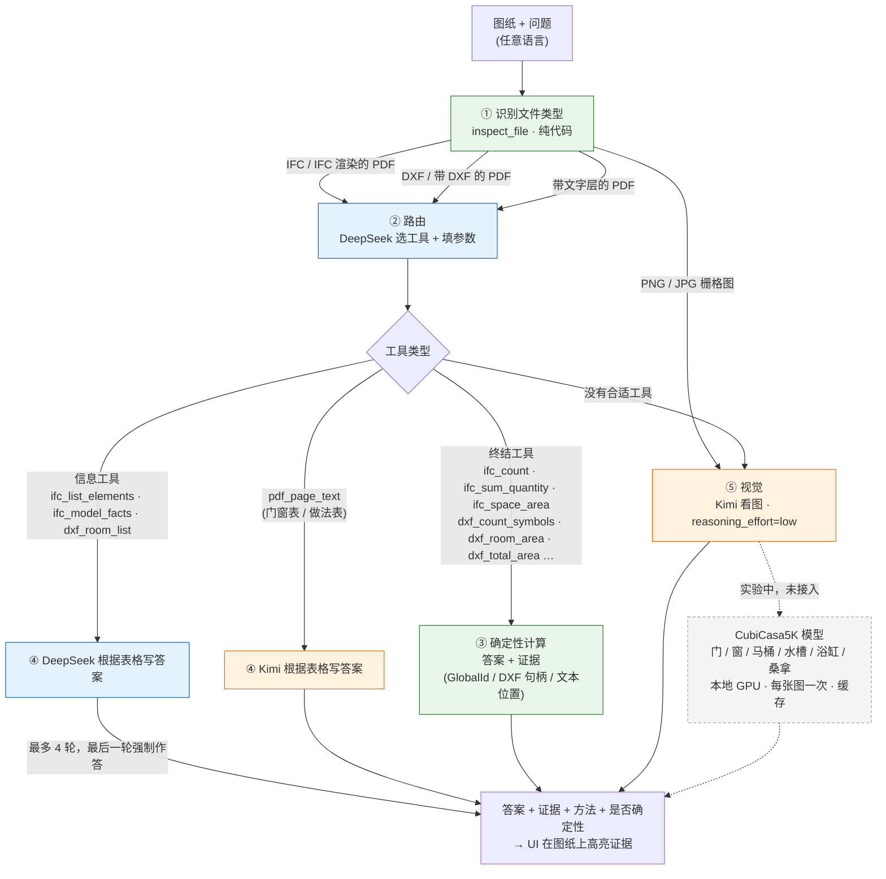

# 问答 Pipeline

默认配置为 `hybrid`（`stoa/pipeline.py` 中的 `PROFILES`）。每次 LLM 调用都会记入 `logs/verda_calls.jsonl`。

图例：绿色为纯代码（免费、可验证），蓝色为 DeepSeek（便宜），橙色为 Kimi（强，但贵约 13 倍），灰色虚线为实验中。

## 每一步给 UI 的数据

| 步骤 | 输出 | UI 可以展示 |
|---|---|---|
| ① 识别文件 | 文件类型、可用工具 | 文件卡片，比如"IFC 模型，3 层，412 个构件" |
| ② 路由 | 工具名 + 参数（`Result.calls`） | "调用了 `ifc_space_area(space_name='ESIK (9-2)')`" |
| ③ 确定性计算 | `Answer.value / unit / method / evidence[]` | 在图纸或 3D 中高亮 evidence：IFC GlobalId、DXF 实体、PDF 文本框 `bbox` |
| ④ 写答案 | 答案 + 一句话说明引用了哪些行 | 引用的表格行 |
| ⑤ 视觉 | 答案 + 模型说明，`deterministic=False` | 低置信度标记，加"请在图上核对" |
| CubiCasa（计划中） | 每个门、窗、洁具的 `bbox` | 逐个框出来，人点一下就能核对计数 |

## 最新评测（同一批 200 题，seed 0）

| 配置 | 数值题 | 文字题 | 每 1000 题成本 |
|---|---|---|---|
| 只用 DeepSeek | 70% | 46% | $0.78 |
| 只用 Kimi | 70% | 50% | $15.45 |
| hybrid（视觉用默认推理强度） | 77% | 54% | $30.98 |
| **hybrid（视觉 `low`，当前默认）** | **79%** | **58%** | $9.51 |

详细数据和端点结论见 `VERDA_LOG.md`。
