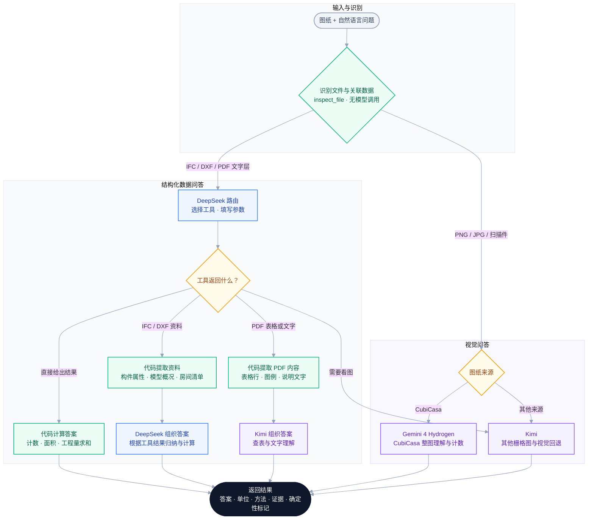

# 图纸问答流程

> **默认配置：`hybrid`**
>
> DeepSeek 选择工具；Gemini 4 Hydrogen 读取 CubiCasa 图纸；Kimi 处理 PDF 表格与其他视觉问题。
>
> 视觉推理统一使用 `low`，输出上限为 4096 tokens。

## 总体流程

**阅读方式：** 绿色表示代码提取与计算，蓝色表示 DeepSeek，紫色表示 Gemini 或 Kimi，深色节点汇总最终结果。

能由单个终结工具直接回答的问题，首轮即可返回。信息工具的结果会交还模型；最多运行 4 轮，最后一轮要求模型作答。

## 结果与证据

| 环节 | 返回的数据 | 可用于界面的展示 |
| :--- | :--- | :--- |
| 文件识别 | 文件类型、关联 IFC / DXF、可用工具 | 图纸信息卡片 |
| 工具调用 | 工具名与参数：`Result.calls` | 展示调用过程与查询条件 |
| 代码计算 | `value`、`unit`、`method`、`evidence[]` | 展示数值、计算方法及来源对象 |
| 资料归纳 | 答案、解释、引用的证据 | 展示引用的构件或表格行 |
| 视觉回答 | 模型估计与页面说明；`deterministic=False` | 标记为待核对，提示人工检查 |

证据可包含 IFC `GlobalId`、DXF 实体句柄、PDF 文本或表格位置。界面可利用已有坐标与对象映射高亮证据；当前整图视觉回答只提供页面级说明。

## 模型配置与评测

### CubiCasa 同题对照

同一批 **30 题，seed 1024**；整图输入、`low` 推理强度、4096 token 上限。

| 视觉模型 | 正确数 | 准确率 | 30 题估算费用 |
| :--- | ---: | ---: | ---: |
| Kimi | 17 / 30 | 56.7% | $0.153496 |
| **Gemini 4 Hydrogen · 当前默认** | **25 / 30** | **83.3%** | **$0.155036** |

这是小样本对照，结果不代表全数据集准确率。

---

配置定义见 [`stoa/pipeline.py`](stoa/pipeline.py)；端点决策与实验记录见 [`VERDA_LOG.md`](VERDA_LOG.md)。所有模型调用记录在 `logs/verda_calls.jsonl`。
