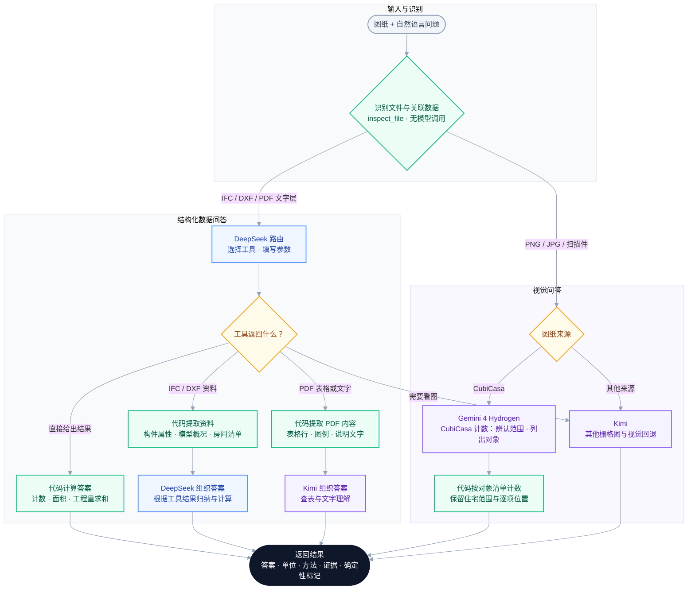

# 图纸问答流程

> **默认配置：`hybrid`**
>
> DeepSeek 选择工具；Gemini 4 Hydrogen 读取 CubiCasa 图纸；Kimi 处理 PDF 表格与其他视觉问题。
>
> 视觉推理统一使用 `low`，输出上限为 4096 tokens。

## 总体流程

**阅读方式：** 绿色表示代码提取与计算，蓝色表示 DeepSeek，紫色表示 Gemini 或 Kimi，深色节点汇总最终结果。

能由单个终结工具直接回答的问题，首轮即可返回。信息工具的结果会交还模型；最多运行 4 轮，最后一轮要求模型作答。

终结工具通过 `answer_directly` 标记是否完整回答问题；部分测量值或需要解释、汇总的结果会继续交给模型。IFC 文本回答可查询精确 GUID、内外墙分类及来源、材料层厚度、项目位置，并使用代码计算的数量、百分比和尺寸统计。DeepSeek 路由上限为 800 tokens，答案组织上限为 4096 tokens。

只复测同一批中的文本题，可在原评测命令后加 `--type text`；筛选发生在抽样之后，保持题目 ID 一致。

## 结果与证据

| 环节 | 返回的数据 | 可用于界面的展示 |
| :--- | :--- | :--- |
| 文件识别 | 文件类型、关联 IFC / DXF、可用工具 | 图纸信息卡片 |
| 工具调用 | 工具名与参数：`Result.calls` | 展示调用过程与查询条件 |
| 代码计算 | `value`、`unit`、`method`、`evidence[]` | 展示数值、计算方法及来源对象 |
| 资料归纳 | 答案、解释、引用的证据 | 展示引用的构件或表格行 |
| CubiCasa 计数 | 清单长度、住宅范围、逐项位置；`deterministic=False` | 核对漏数、重复与邻居残图 |
| 其他视觉回答 | 模型估计与页面说明；`deterministic=False` | 标记为待核对，提示人工检查 |

证据可包含 IFC `GlobalId`、DXF 实体句柄、PDF 文本或表格位置。界面可利用已有坐标与对象映射高亮证据；CubiCasa 计数提供房间与相对位置文字，不提供精确对象框。

CubiCasa 中以 `How many` / `Kuinka monta` 开头的计数题会先辨认住宅范围，排除邻居残图，并保留同一住宅的多个楼层。模型每列出一个对象，代码计数一次；评测文件保留完整清单。对象识别仍由模型完成，因此不标记为确定性答案。截断或无效清单记为失败，并保留调用费用。其他问法继续使用通用视觉提示词。

### IFC 分组统计：`ifc_group_quantity`

一个 IFC 类按类型、厚度、材料、楼层、预定义类型（FLOOR/ROOF/BASESLAB）或内外墙分组，每组给出数量、占比、厚度（门窗给尺寸）以及可选的工程量合计，每个构件以 GlobalId 作为证据。传 `only` 时只返回一个组的数值，例如"250 mm 楼板的面积"。

- 厚度依次取自：材料层集合 → Qto `Width` → Pset 中的 Thickness / Dicke / Standarddicke → 几何体积除以投影面积（楼板）或侧面积（墙），几何推算的结果取整到 5 mm 并标 "≈"。
- 内外墙依次取自：`Pset_*Common.IsExternal` → CAD 图层名，例如 ArchiCAD 的 `Ebene` "Außenwände"。
- 配筋：报告名称含 Bewehrung / Reinforcement / Rebar 的属性，并统计 `IfcReinforcingBar` 的数量。预览数据里没有真正的钢筋数据，只有保护层（c=2.0cm）这类属性，答案里会如实说明。
- ifc_bench 同 40 题（seed 0）：文字题得分 51.2% → 63.7%，确定性答案占比 0% → 50%，成本基本不变（每 1000 题 $1.60 → $1.63）。

### 管道：`ifc_piping`（`stoa/tools/mep_tools.py`）

统计管段（数量、长度）、管件、阀门、卫生器具和水泵，可按系统、管径、材料、楼层或类型分组；`what='all'` 时给出各系统的概况。IFC4 的 `IfcPipeSegment` 等类型和 IFC2X3 的 `IfcFlowSegment` 加类型对象两种写法都支持。

- 系统归属：先看 IfcSystem 分配，再看 Revit Pset `Mechanical."System Type"`。不用 `System Classification`：clinic 模型里有 999 个热水管件被标成了冷水，端口连接关系证明它们接在热水管上。
- 管长：依次取 Qto → `Dimensions.Length` → 几何包围盒最长边（含竖直方向，立管也能算进去）。
- 楼层：先取 Revit 的 `Constraints.Level`，再看空间包含关系。原因是 Revit 把 1359 个管件挂到了基础层上。
- 卫生器具当量：热水组用 HWFU，冷水组用 CWFU，其余分组用 WFU。
- 有管道的模型会在路由提示里加一行管道概况。clinic 模型的 7 道测试题都在一次路由内答对，每题约 $0.0005。
- UI：`stoa.ui.facts` 用模型几何为每层生成一张管道平面图，按系统着色，每个构件按 GlobalId 都能点选，问答证据直接高亮（`ifc_models/bsc-clinic_clinic-plumbing_piping-level-1/2`）。

### 踢脚线：`dxf_baseboard_length`

计算 Swiss DXF 平面图上踢脚线的延米数：取房间轮廓中贴着墙或窗的部分（WALL/WINDOW 几何外扩 3 cm），窗下视为有墙。门洞和开放边是墙上的缺口，会自动排除，不用另外识别门宽。

- 在 77 间卧室（Zimmer）上验证：不贴墙部分的中位数是 0.82 m，正好一个门宽。偏大的房间，逐个画出来核对，都是多扇门或双开门。
- 可以选单个房间、某个标签、某户，或者全部室内房间；`exclude_wet` 去掉卫生间和 WC（各语言的名称，以及未命名的编号房间）。
- 证据是每一段踢脚线（`<房间句柄>:sk<i>`）。`stoa.ui.facts` 把它们画成 4 cm 宽的线带，在 "Lengths" 组里高亮。
- 尚未处理：厨房橱柜背后的墙仍计入踢脚线；IFC 模型（IfcSpace）还没有对应工具。

## 模型配置与评测

### CubiCasa 同题对照

同一批 **30 题，seed 1024**；整图输入、`low` 推理强度、4096 token 上限。

| 视觉模型 | 正确数 | 准确率 | 30 题估算费用 |
| :--- | ---: | ---: | ---: |
| Kimi | 17 / 30 | 56.7% | $0.153496 |
| **Gemini 4 Hydrogen · 当前默认** | **25 / 30** | **83.3%** | **$0.155036** |

这是小样本对照，结果不代表全数据集准确率。

---

配置定义见 [`stoa/pipeline.py`](stoa/pipeline.py)；端点决策与实验记录见 [`VERDA_LOG.md`](VERDA_LOG.md)。所有模型调用记录在 `logs/verda_calls.jsonl`。
